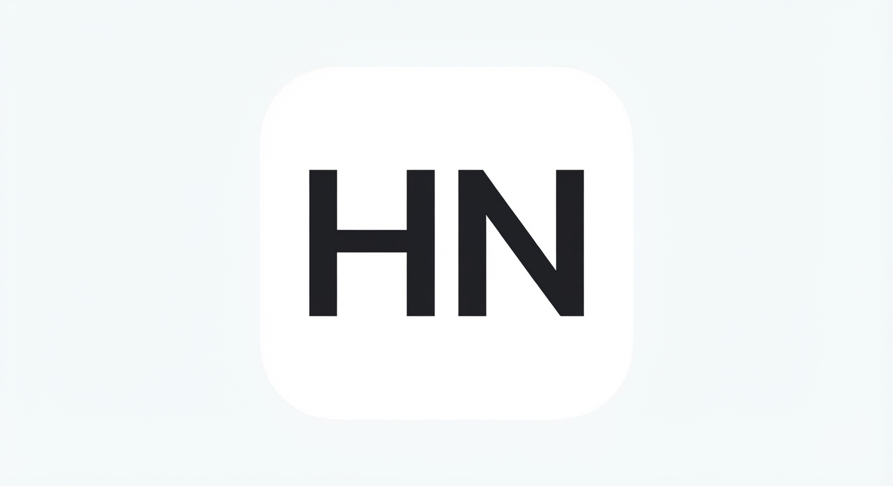

# 🌌 HyperNexus v1.5.0 - Ultimate Android System Modification Suite

  
   
  
<b>Desarrollado exclusivamente desde un entorno móvil (Termux) por @leeeyrux</b>

  
  
  
  

---

## 🔍 ¿Qué es HyperNexus?
**HyperNexus** (Hyper = *Completo* | Nexus = *Conectado*) es una suite avanzada de optimización, diagnóstico y modificación de bajo nivel para el sistema operativo Android. Nace con el objetivo radical de **eliminar la saturación, las interfaces confusas y la publicidad invasiva** de las herramientas comerciales tradicionales, centralizando el poder de **5 aplicaciones independientes en un entorno único, ultra-ligero (16 MB) y de alto rendimiento**.

La aplicación opera bajo un modelo híbrido: ejecuta lecturas locales de telemetría sin privilegios elevados y despierta su motor de inyección de comandos de escritura mediante el puente **Shizuku / ADB shell**, eliminando la necesidad obligatoria de acceso Root en dispositivos modernos.

---

## 🛠️ Arquitectura y Características por Módulo

El sistema está estructurado mediante una interfaz monolítica de **7 pestañas principales** integradas en un contenedor de navegación flotante:

### 1. 📊 Panel de Telemetría en Vivo (Home Dashboard)
Centro de control enfocado exclusivamente en la monitorización de datos en tiempo real (Cero botones de configuración que obstruyan la vista).
* **Frecuencias de CPU Activas:** Mapeo sutil por clúster (Core #0 a Core #7) extrayendo las frecuencias reales directo de `/sys/devices/system/cpu/cpu*/cpufreq/scaling_cur_freq`.
* **Métricas Energéticas de Batería:** Diagnóstico preciso de Salud de Celda, Tensión Exacta (mV), Amperaje Instantáneo (mA), Tipo de Química (Li-poly) y Capacidad Máxima Real.
* **Conectividad y Red:** Sensor de Latencia de Ping (ms), Potencia de Señal exacta (dBm) y Tipo de Enlace activo (Wi-Fi 2.4/5GHz o Redes Móviles 4G/5G).
* **Botones Rápidos de Acción:** Limpieza de memoria RAM instantánea, Gaming Boost y un script de inyección térmica de red denominado `Optimizar Ping`.

### 2. ⚡ Rendimiento (System Performance Tweaks)
Control técnico de parámetros visuales y de procesamiento del sistema operativo mediante un sistema de **Chips Discretos con Memoria Persistente**.
* **Densidad de Pantalla (DPI Seguro):** Modificador de DPI con saltos fijos de 20 en 20 en rangos estrictamente seguros (320 a 500 DPI) para evitar el colapso de la pantalla por malas configuraciones.
* **Escalas de Animación Avanzadas:** Configuración por chips de Escala de Transición, Animación/Duración y Escala de Ventana, ofreciendo multiplicadores oficiales de `0x (Apagadas)`, `0.5x`, `1x`, `1.5x` y `2x`.
* **Escalador de Resolución Protegido:** Modificador de resolución (`wm size`) calibrado bajo el formato de aspecto seguro base **720x1600** para evitar la pérdida de zonas táctiles o botones del sistema.
* **Filtro "Anti-Curiosos" Integrado:** Banner y diálogo de advertencia en rojo brillante que previene a usuarios inexpertos antes de alterar configuraciones críticas mediante el aviso legal del *"Che Jorge el Curioso"*.

### 3. 🎮 Gráficos Avanzados & Game Manager API
Suite de inyección para aceleración de renderizado en títulos de alta demanda gráfica (como Call of Duty, Blood Strike, Brawl Stars y Free Fire).
* **Filtro de Aplicaciones Inteligente:** Motor unificado e ilimitado que escanea el sistema mediante `Intent.CATEGORY_LAUNCHER`, aislando los juegos del usuario en la parte superior del menú desplegable de forma alfabética con sus respectivos iconos nativos y enviando las utilidades de sistema al fondo.
* **Túnel de Renderizado Forzado:** Modificación de variables del sistema en caliente para forzar la composición de pantalla mediante motores avanzados: **Vulkan Booster, Vulkan Lite, OpenGL SkiaGL y OpenGL Lite**.
* **Tweaks de Estabilidad:** Alternadores para `VSYNC Bypass`, `Forzar Renderizado GPU`, Perfiles de optimización táctil (`Touchscreen Optimized`) y controladores térmicos de hardware (`Thermal Controller`).
* **Contador Red Magic Multi-Info Overlay:** Servicio de ventana flotante (`WindowManager`) interactivo y resistente a fallos de ciclo de vida. Con un solo tap en pantalla alterna entre un contador minimalista ("58 FPS") y una barra completa de telemetría gamer gris translúcida con tipografía blanca futurista que muestra: `[ Hora | FPS | Ping | Temp | Batería ]`.

### 4. 🛡️ Seguridad & Red Gamer (Cybersecurity Dashboard)
Panel de mantenimiento y privacidad con un diseño visual interactivo de alta fidelidad.
* **Medidor de Protección Circular:** Anillo dinámico animado con un `100% Protection Score` sobre gradientes oscuros.
* **Hyper Cleaner / Booster Engine:** Barra segmentada horizontal multicolor que muestra el almacenamiento real y ejecuta un borrado secuencial ultrarrápido de archivos temporales y cachés residuales a velocidades de `157 MB/sec` usando comandos `pm trim-caches 999G`.
* **Auditor de Vulnerabilidades del Sistema:** Lista de verificación con checks verdes que evalúa el estado del cifrado del dispositivo, bloqueo de pantalla, depuración por desarrollo y estado de protección de Google Play Protect.
* **Túnel VPN Gamer de Privacidad (Split Tunneling):** Servicio nativo integrado (`VpnService`) con un interruptor maestro que genera un puente local de red con MTU optimizado a 1400 bytes y DNS de baja latencia (Cloudflare 1.1.1.1). Su arquitectura de túnel dividido redirige el tráfico cifrado **únicamente hacia el juego seleccionado en la lista superior**, dejando las apps normales de fondo libres de lag de red.

### 5. 🗂️ Módulos Universales (Custom Mod Installer)
Un motor de instalación de modificaciones global que rompe las barreras restrictivas de software propietario.
* **Instalador de Almacenamiento Interno:** Abre un selector de archivos nativo de Android que permite cargar cualquier script de comandos `.sh` o perfiles de propiedades de tweaks de forma externa desde `/sdcard/HyperNexus_Modulos/`.
* **Control de Módulos:** Añade de forma dinámica interruptores de activación, desactivación y botones de remoción rápida en tarjetas flotantes independientes.
* **Módulos Preset Sugeridos:** Incluye de fábrica 4 optimizaciones automatizadas: *FPS Stabilizer Tweak*, *Touch Response Booster*, *Thermal Throttling Bypass* y *Network Ping Optimizer*.

### 6. 💻 Terminal ADB Embebida (Shizuku Console Engine)
Una consola interactiva de comandos del sistema integrada en la interfaz que elimina por completo la necesidad de una computadora externa para tareas de depuración.
* **Ejecutor Asíncrono:** Entrada de comandos de texto en crudo procesados a través del contexto Binder de Shizuku.
* **Presets de un Solo Toque:** Lista de 10 comandos ADB populares pre-cargados listos para ejecutarse (Modo Doze Extremo, Deep Sleep, forzar compilación Speed global, auditoría Logcat de crashes, etc.).
* **Sistema de Marcadores:** Permite almacenar cadenas de comandos personalizados en una lista local de favoritos mediante interacciones de "Me Gusta".

---

## 🎨 Especificaciones del Motor Gráfico y Experiencia Visual (UI/UX)
HyperNexus no es una aplicación de terminal tosca; implementa una interfaz de alta fidelidad basada en pautas **Sci-Fi Cyber-Dark & Glow Glassmorphism**:
* **The Floating Liquid Glass Capsule:** La barra de navegación inferior de 7 pestañas ha sido transformada en una cápsula ovalada flotante estilo iOS despegada de los bordes. Utiliza un fondo gris carbón translúcido (`Color(0x991A1A1A)`) procesado mediante desenfoques de mapa de bits en tiempo real (`Modifier.blur(12.dp)`). El contenido del scroll y las tarjetas de la app pasan de forma fluida y distorsionada por detrás del cristal de la barra.
* **Navegación por Scroll Horizontal Líquido:** Permite deslizar los 7 iconos de pestañas de lado a lado dentro del óvalo con el pulgar. Los elementos se desplazan usando una animación cúbica 3D no lineal regulada por una curva `FastOutSlowInEasing` que aporta peso físico y rebote elástico.
* **Estilo Monochrome Bold-White:** Se eliminaron los colores saturados para las selecciones activas. Las pestañas inactivas permanecen en gris tenue, mientras que el apartado seleccionado se ilumina al instante en **Blanco Puro Brillante con tipografía gruesa (`FontWeight.Bold`)**, ofreciendo un contraste impecable de alta gama.
* **Social Media Scroll Cache Shield:** Todas las listas e iconos de juegos cargan mediante claves fijas (`key = { it.packageName }`), tipos de celda reutilizables (`contentType`) y almacenamiento en caché gráfica (`Modifier.drawWithCache`). La animación tridimensional de entrada en cascada de las tarjetas se congela mediante un bloqueo booleano una vez mostrada; si el usuario sube y baja rápido por el Panel, las animaciones ya no se recalculan, permitiendo un scroll limpio, ligero y suave idéntico al feed de TikTok que no suelta los 60Hz.

---
*HyperNexus es software libre, transparente y diseñado para llevar el control de tu dispositivo al límite. El uso indebido de las opciones avanzadas de hardware es responsabilidad única del usuario.*
